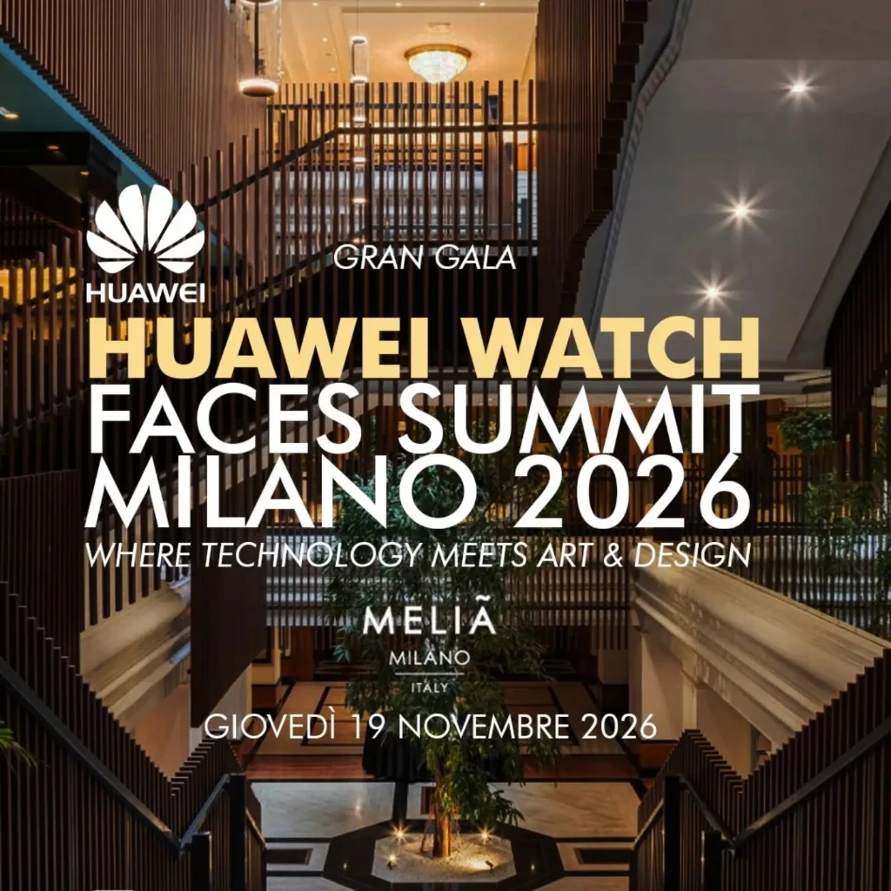

I am proud to share a major milestone for **Creation Cue™ Studio**: at the **Huawei Watch Face Summit Milano 2026** on November 19, 2026, I was honored with the **Rising Star Award**!

Being invited in person to the Milan summit and gala to receive this recognition makes this milestone especially meaningful.

---

## Highlights from Milan

- **Rising Star Award**: Recognized by Huawei Themes for craft, visual clarity, and momentum across smartwatch watch face design.
- **Connecting with Fellow Creators**: Meeting other talented watch face designers and the Huawei team in Milan was an inspiring reminder of how fast wearable design is evolving.
- **Looking Ahead**: This award motivates me even more to keep pushing clean typography, battery-optimized layouts, and refined aesthetics across both **Huawei** and **Wear OS** smartwatches.

---

## Official Press Coverage

Read Huawei's official press release covering the summit and award winners on PR Newswire:

- **[Huawei Unites Europe's Creative Talent at the HUAWEI Watch Faces Summit Milano 2026](https://www.prnewswire.com/news-releases/huawei-unites-europes-creative-talent-at-the-huawei-watch-faces-summit-milano-2026-302946012.html)** *(PR Newswire — English)*

---

## Thank You!
A huge thank you to everyone who wears, rates, and supports Creation Cue™ watch faces every day—none of this happens without you.

👉 Explore our **[Huawei Watch Collection](/huawei)** or browse all **[Wear OS Watch Faces](https://creationcue.web.app/)**!
