Looking for the **best free Wear OS watch faces** for your **Samsung Galaxy Watch** (Watch Ultra, Watch 7, Watch 6, Watch 5, Watch 4) or **Google Pixel Watch** without spending a cent? Every watch face below is built with Google's official battery-friendly **Watch Face Format (WFF)**, features true-black Always-On Display (AOD) support, and is **100% free** to download on the Google Play Store.

Here are all **13 free Creation Cue™ watch face apps** available for Samsung Galaxy Watch, Google Pixel Watch, TicWatch, OnePlus Watch, and other Wear OS smartwatches.

---

## 1. Analog Watch Face CRC046 (100K+ Downloads)
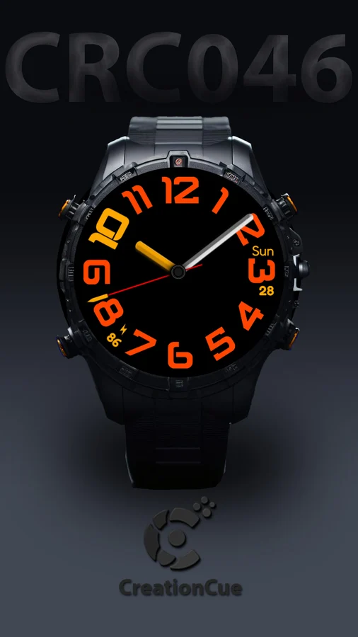

Our most popular free watch face with over 100,000 downloads. **CRC046** blends classic mechanical chronograph styling with modern smartwatch clarity, featuring crisp analog hands, subtle dial depth, and essential daily indicators.

👉 **[Get CRC046 Free on Google Play](https://play.google.com/store/apps/details?id=com.creationcue.crc046)**

---

## 2. Analog Watch Face CUE136 (50K+ Downloads)
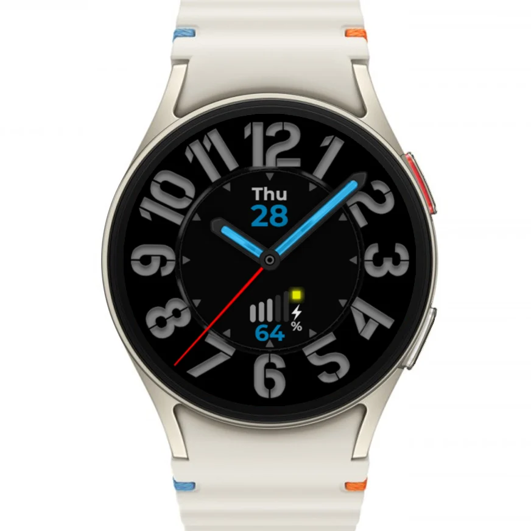

A refined, clean analog design crafted for everyday elegance. **CUE136** delivers sharp legibility, balanced dial proportions, and a minimalist battery-conscious Always-On Display.

👉 **[Get CUE136 Free on Google Play](https://play.google.com/store/apps/details?id=com.creation.cue136watchface)**

---

## 3. Digital Watch Face CRC080 (50K+ Downloads)
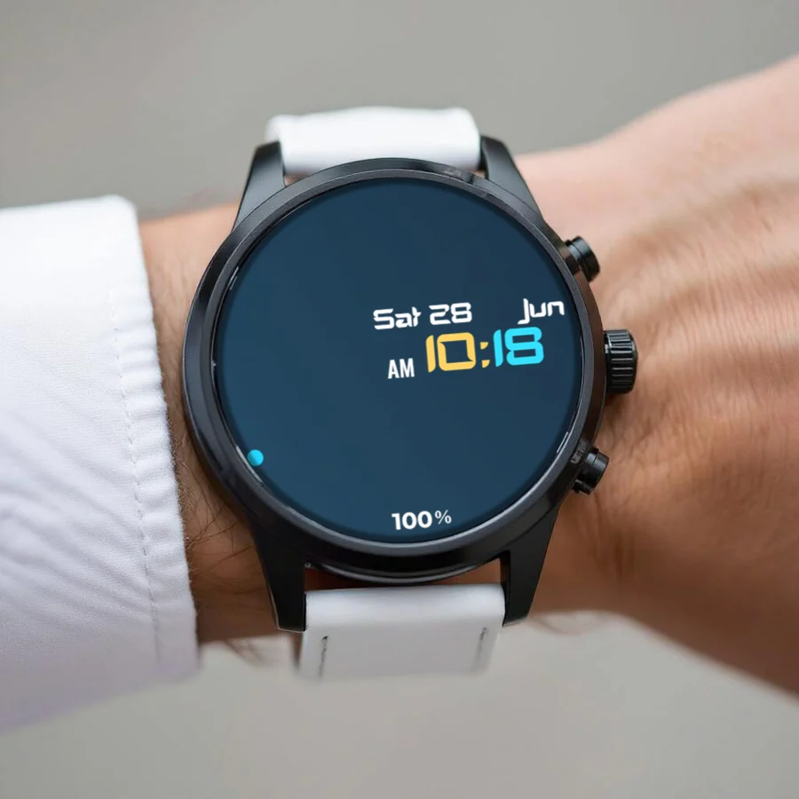

A bold, high-contrast digital watch face built for instant glanceability. **CRC080** presents large time digits alongside quick fitness and battery stats in a sleek dark layout.

👉 **[Get CRC080 Free on Google Play](https://play.google.com/store/apps/details?id=com.creationscue.crc080watchface)**

---

## 4. Digital Watch Face CRC041 (50K+ Downloads)
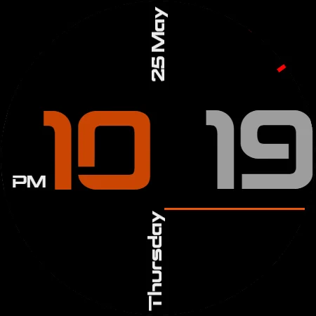

Sporty, structured, and easy to read in any lighting. **CRC041** keeps your time, date, steps, and key smartwatch metrics organized into clean, modern panels.

👉 **[Get CRC041 Free on Google Play](https://play.google.com/store/apps/details?id=com.watchfacestudio.crc041)**

---

## 5. Watch Face CUE Indus (10K+ Downloads)
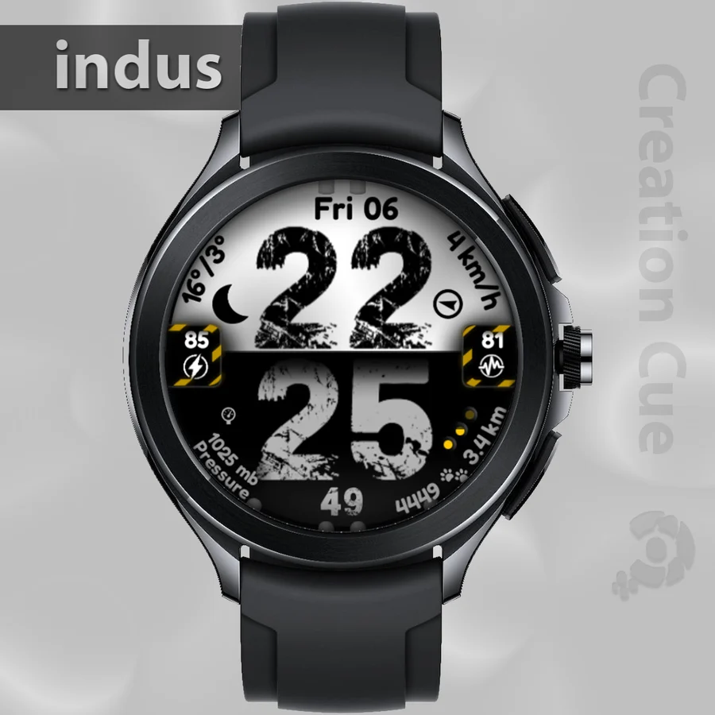

An industrial-inspired digital watch face with rugged character and sharp typography. **CUE Indus** combines tactical styling with smooth Wear OS performance.

👉 **[Get CUE Indus Free on Google Play](https://play.google.com/store/apps/details?id=com.creation.cueinduswatchface)**

---

## 6. Digital Watch Face CRC069 (10K+ Downloads)
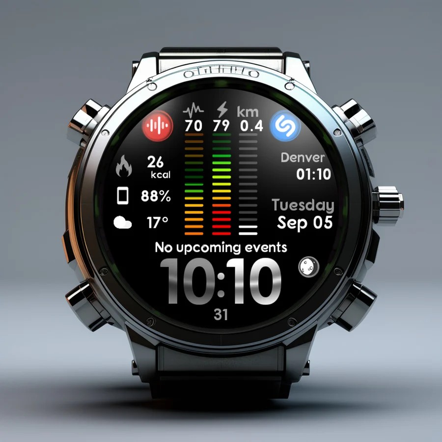

Clean, modern, and built for daily productivity. **CRC069** offers a crisp digital readout with balanced spacing and customizable complication slots.

👉 **[Get CRC069 Free on Google Play](https://play.google.com/store/apps/details?id=com.creationcue.crc069watchface)**

---

## 7. Digital Watch Face CRC068 (10K+ Downloads)
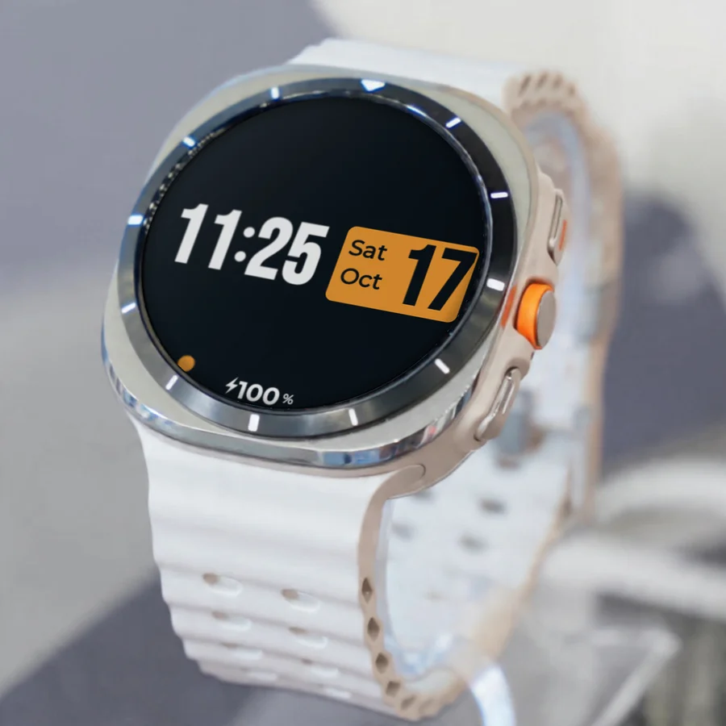

A sleek, dark-themed digital watch face designed to save AMOLED battery while keeping your essential stats front and center.

👉 **[Get CRC068 Free on Google Play](https://play.google.com/store/apps/details?id=com.creationcue.crc068watchface)**

---

## 8. Analog Watch Face CUE132 (5K+ Downloads)
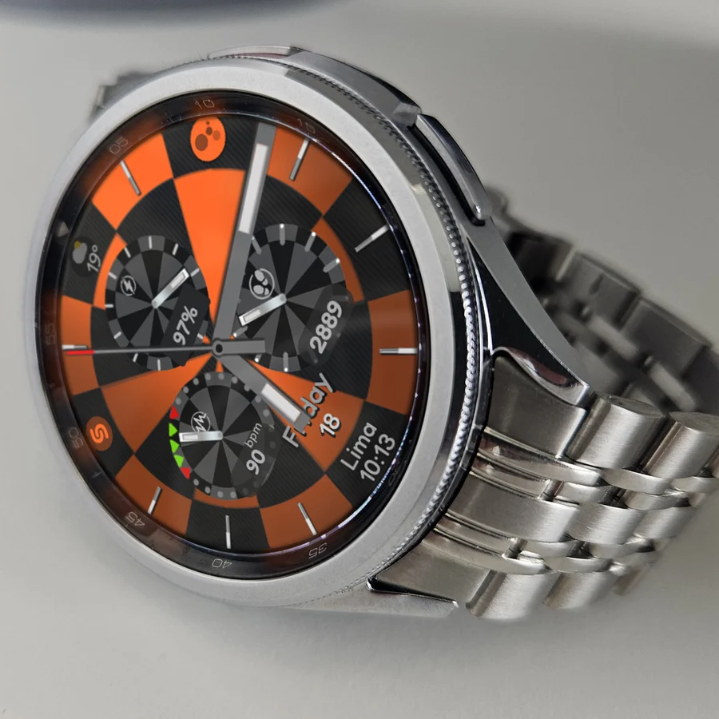

Timeless analog proportions with a modern twist. **CUE132** pairs classic watch hands and clean hour markers with smart complication support for both dress and casual wear.

👉 **[Get CUE132 Free on Google Play](https://play.google.com/store/apps/details?id=com.creation.cue132watchface)**

---

## 9. Digital Watch Face CUE104 (5K+ Downloads)
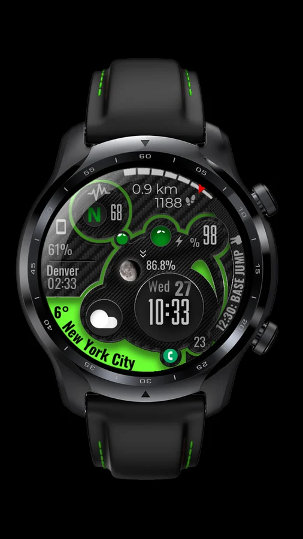

A streamlined digital layout focused on clarity and speed. **CUE104** displays oversized time digits with subtle accent highlights and low-power AOD.

👉 **[Get CUE104 Free on Google Play](https://play.google.com/store/apps/details?id=com.creation.cue104watchface)**

---

## 10. Streamline Watch Face CRC023 (5K+ Downloads)
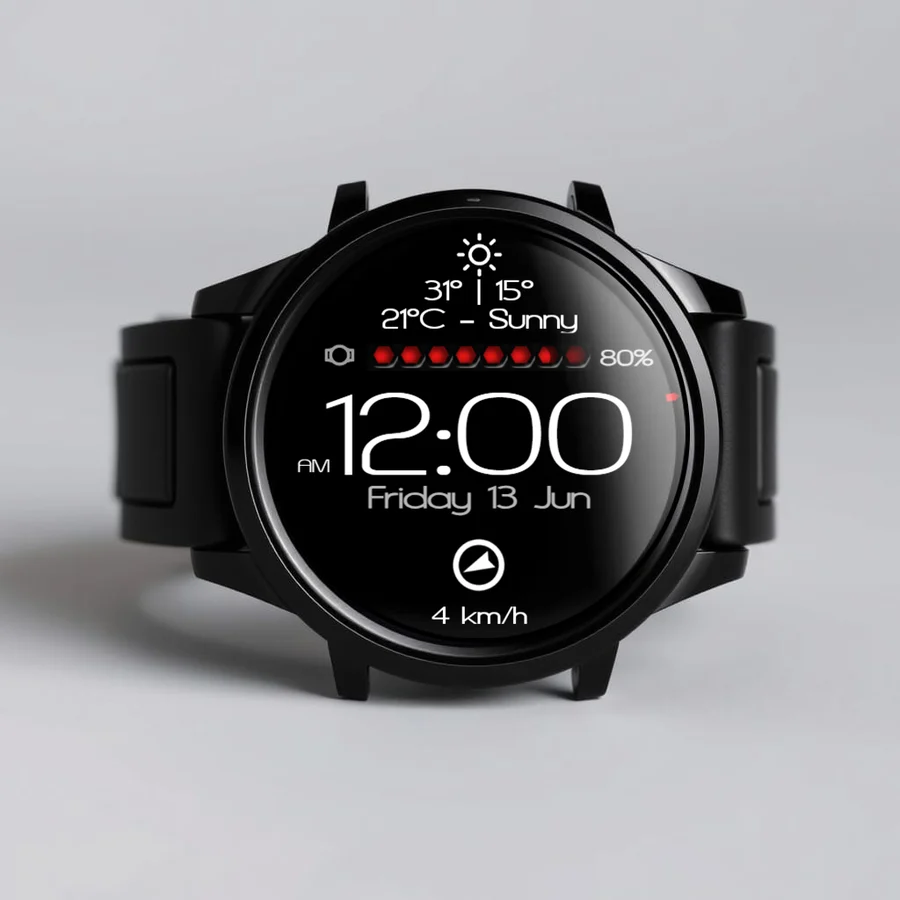

Minimalist and fluid, **CRC023** strips away visual clutter to leave you with a fast, distraction-free digital smartwatch experience.

👉 **[Get CRC023 Free on Google Play](https://play.google.com/store/apps/details?id=com.watchfacestudio.crc023)**

---

## 11. Analogue Watch Face CRC082 (1K+ Downloads)
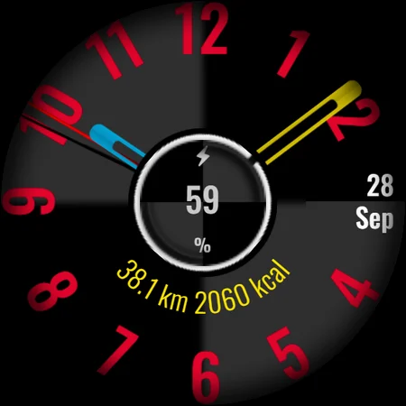

A sharp, versatile analog watch face featuring clean dial markers, refined hands, and subtle smartwatch data integration.

👉 **[Get CRC082 Free on Google Play](https://play.google.com/store/apps/details?id=com.creationcue.crc082watchface)**

---

## 12. Commander Watch Face CRC036
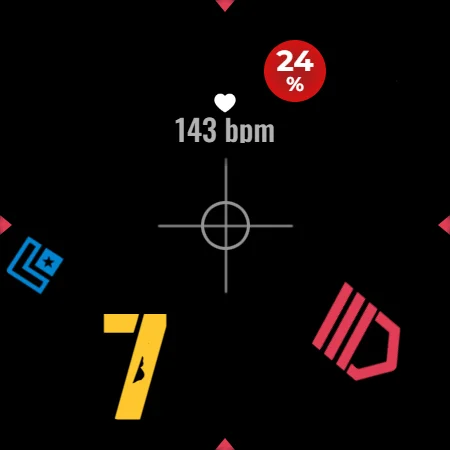

Built with a tactical command-center aesthetic, **CRC036** frames your time and daily activity data inside structured, high-legibility digital modules.

👉 **[Get CRC036 Free on Google Play](https://play.google.com/store/apps/details?id=com.watchfacestudio.crc036)**

---

## 13. Japan Fusion Watch Face CRC027
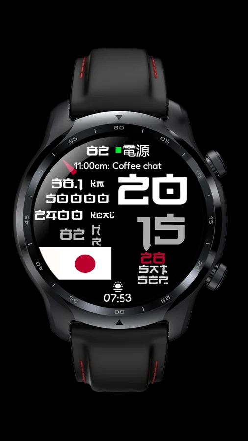

Inspired by retro-futuristic Japanese digital watches, **CRC027** brings a distinctive, stylish digital look to modern Wear OS smartwatches.

👉 **[Get CRC027 Free on Google Play](https://play.google.com/store/apps/details?id=com.watchfacestudio.crc027)**

---

## Frequently Asked Questions (FAQ)

### How do I install these free watch faces on my Samsung Galaxy Watch or Pixel Watch?
Tap any **Google Play** link above on your phone, select your smartwatch from the **Install on more devices** dropdown, and wait a couple of minutes for it to sync. Need step-by-step screenshots? Check our **[Wear OS Watch Face Installation Guide](https://creationcue.web.app/install)**.

### Do these free watch faces drain smartwatch battery?
No. Every Creation Cue™ watch face adheres to Google's native **Watch Face Format (WFF)** standard—meaning zero background code execution and true-black Always-On Display (AOD) modes optimized for AMOLED screens.

### Are all 13 watch faces really 100% free?
Yes! All 13 watch faces listed in this guide are completely free to install and use on Google Play with no hidden subscriptions.

---

### Want to Explore More?
Browse the full collection of over 115 Wear OS watch faces—including analog, digital, hybrid, neon, and weather-ready designs—on the **[Creation Cue™ Hub](https://creationcue.web.app/)**.
